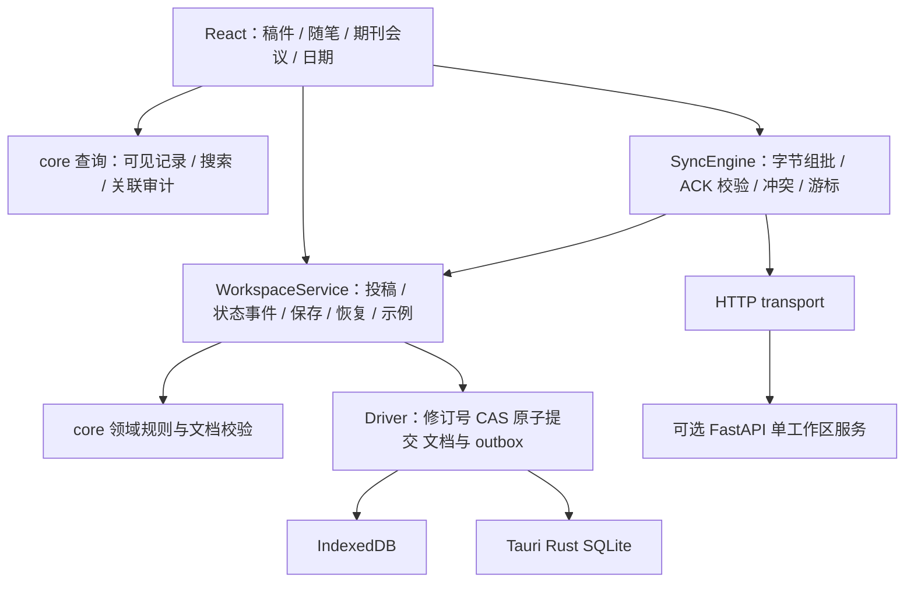

# SciMemo 架构评估与演进决策

日期：2026-10-13。与 [科研流程评估](RESEARCH_WORKFLOW_REVIEW.md)、[实际验证报告](TEST_REPORT.md) 配套阅读。本文明确区分本轮实现和后续设计，不代表原生发行验收。

## 1. 判断

当前架构适合个人、多稿件、本地优先的科研手账。四个模块和 Paper 同步聚合是合理基线；没有证据支持换框架、拆微服务、引入项目层级或 CRDT。主要欠缺是业务入口集中程度、双端验证的一致性、同步的容量与响应边界，以及原生存储和恢复的实测。

成熟度应按证据判断：领域和协议可回归、Web 可以构建，但浏览器持久化、原生重启、升级、备份恢复、设备间冲突还需要分别验证。测试数不能转换成“完成百分比”。

## 2. 本轮落实后的分层

这是单仓库中的职责划分，不是新增部署单元。领域核心不导入 React、Tauri 或 HTTP。UI 可以管理表单草稿和显示状态；投稿规则、恢复事务、outbox 构造由业务服务负责。文件导出的平台适配仍保留在 platform。

| 职责 | 当前入口 | 必须保持的边界 |
|---|---|---|
| 业务命令 | `WorkspaceService.recordSubmission/recordSubmissionEvent/put/remove/restore/resolve/restoreBackup/loadDemo` | UI 不直接构造 outbox，不调用通用 update/commit 写工作区 |
| 领域规则 | `core/domain.ts` | 状态与工作阶段独立；一个活跃投稿；转投留旧记录；未知历史日期保持 null |
| 派生查询 | `visible/searchDocs/auditReferences` | 从业务文档计算，无独立同步状态，不修改原记录 |
| 原子持久化 | `Driver.save(expectedRevision,next)` | 文档、删除标记、outbox、冲突和游标同一事务；失败不能回退内存冒充成功 |
| 同步 | `syncOnce` + `SyncTransport` | 服务端版本与幂等 ID 决定接收；本机时钟不决定覆盖 |
| 外部边界 | TS 校验、JSON Schema、Python 语义校验 | 同一虚构样例双端验证；字段变更需版本与迁移 |

`update/commit/exclusive` 仍作为核心同步与事务组合机制存在，本轮没有把它们做成通用插件接口。`put` 的递增 updatedAt 仅用于本地陈旧编辑器检测与展示，不是远程最后写入获胜算法；后续可用显式文档本地修订号替代，须迁移。

## 3. 已发现并修复的问题

| 问题与触发 | 修复结果 | 回归证据 |
|---|---|---|
| UI 先检查空工作区、再另开事务加载示例，期间可能出现其他编辑 | 空工作区检查和示例/outbox 写入由同一业务命令串行执行；备份恢复同理 | 排队编辑与示例/恢复竞态测试 |
| put 可本机更改 kind/createdAt，随后服务器拒绝同步；队列等待时调用者可修改传入对象 | 保存入口先拍快照，校验不可变身份，并在生成保存元数据后再次验证 | 身份不可变、排队输入、保存失败原子性测试 |
| 每批只限制100条，合法中文大随笔合计可超过服务器5MB请求限制 | 完整请求JSON按UTF-8精确组批，每轮≤4MB且≤100条；余项留在outbox | 大中文批次、计数限制、真实HTTP脚本 |
| 非法ACK/游标/序号或被改写正文可能进入本机状态 | 校验工作区标识、ACK身份/版本/内容、分页顺序与游标；异常整轮回滚、保留幂等键 | 畸形响应、丢失确认、冲突、删除测试 |
| TS允许额外字段和归一化后的错误日期，服务端规则不同；字符长度不等于UTF-8字节 | 对齐当前schema字段与历法/RFC3339规则；共享样例双端执行；服务器显式安装时间检查依赖 | 32条共享用例、中文/emoji和尺寸边界 |
| 服务器版本9→10可能把500000字节文档增长至500001字节后提交 | 生成服务端版本后再次验证，超限则整批回滚；修正尺寸后可重试 | HTTP版本增长/幂等记录/变更日志回滚测试 |
| 修回事件与日期入口割裂；弱关联失效却难以发现 | 稿件详情查看/编辑/预关联新日程；设置页只读关联审计 | 核心关联审计回归；界面交互仍待实测 |
| 编辑稿件摘要可能按期刊列表顺序改写候选priority | 保留既有priority，新目标追加，保存时按priority排序 | 代码检查；显式调整优先级UI仍待实现 |
| ICS导出直接传递不安全来源协议 | 导出仅允许http/https URL，保留原始记录供用户检查 | 不安全URL导出测试 |

本轮未改变 v1 业务字段、备份格式、Paper 聚合或历史迁移。既有符合 schema 的记录无需迁移；先前被宽松校验误接受的非法记录会明确报错，需要保留原备份后人工纠正，不能静默丢弃额外字段或伪造日期。

## 4. 仍需完成的工程设计

| 优先级 | 已确认的限制 | 下一步设计与验收 |
|---|---|---|
| P0 / Alpha门槛 | 浏览器和原生存储未完成真实交互、重启、异常退出验证 | 分别验证 IndexedDB/SQLite 的持久化、容量失败、CAS冲突、备份恢复。MemoryDriver只能证明核心规则 |
| P1 | SQLite读取多次SELECT没有同一读事务，跨进程可能读到混合快照 | 原生读取包只读事务；用两个独立连接验证并发写入期间revision/docs/outbox一致；新增迁移不改001含义 |
| P1 | syncOnce在整个网络请求期间持有服务写队列，慢网络会延迟本机保存 | 设计“短事务拍下不可变待发操作→网络→短事务按opId确认”，保留在途重试；用同步期间再次编辑/删除/跨窗口CAS测试验证。不能只移除锁 |
| P1 | 下载最多100页，默认200条/页；历史超过20000条时整轮回滚可能反复无法追上 | 增加分页检查点及明确可继续状态，cursor与已应用文档同事务；界面区分本轮成功和全部追平；覆盖中途退出/重复下载/服务端恢复 |
| P1 | 整工作区重写、冲突档案与服务变更历史持续增长；原生有30MB工作区上限 | 用100/1000/10000条虚构记录测量P50/P95保存、打开、搜索耗时与体积，再决定增量提交/索引；不提前承诺性能。压缩前设计设备确认水位，不能随意回收tombstone |
| P1 | 精确时刻只核时区名称，未核日期对应的偏移一致性；新JS运行时的固定偏移时区支持可能与Python不同 | 用共享时区用例覆盖DST、AoE、别名及offset冲突，明确IANA接受范围；只提示用户核查，不能自动替换原时刻 |
| P1 | 自动备份、草稿恢复、原生导出原子替换未实现 | 草稿为本机独立状态，不混入正式投稿与outbox；备份临时文件写完校验后原子改名；失败可见、保留策略明确，恢复到空工作区演练 |
| P2 | 校验三处维护、schema与业务规则可能漂移 | 继续共享正反样例；后续用schema生成结构校验，单独维护聚合语义。不要把生成类型当作完成业务验证 |

本轮添加了隔离HTTP测试启动器 `scripts/test-http-integration.py`：临时数据库、随机测试令牌、真实TypeScript transport、结束时清理进程和目录。它不读取或覆盖开发者的真实工作区。

## 5. v2历史纠错设计，尚未实现

需要保留“事实发生”“现在补录”“现在纠正”三种语义。建议 Paper 内增加不可变的修订记录，指向稳定 Submission/Event ID，携带前后值、原因和录入时间；由纯函数生成有效展示。补录更早事件不应自动改变已确认的当前状态。确切字段、修订相互覆盖与撤销规则需先定，再落模型。

迁移顺序：定义v2不变量和正反样例 → 更新TS类型/校验、schema、Python验证、备份协议 → 新增v1→v2纯迁移与SQLite新迁移 → 验证旧备份/旧设备/冲突恢复 → 开放UI。保留原v1导出；不修改001迁移，不把历史状态重新按本机时钟排序，不把旧Note自动解释成结构化权威记录。

在v2前，逐条审稿回应、投稿检查清单、研究决定和发表DOI可先采用可选Note模板。附件必须单独存内容寻址文件与元数据，不塞进Paper正文；增加附件后必须把备份和同步一起设计。

## 6. 交付顺序

先达到“记录不丢、错误可见、备份可恢复、状态可解释”的桌面Alpha，再做历史纠错与草稿保护；随后改善同步并发与容量、设备授权和小附件，最后分别验收移动端、签名和更新。

现阶段不需要账号中心、微服务、复杂项目树、自动投稿站抓取或必需AI。下一轮投入优先放在实际保存/恢复与可信历史，按 [ROADMAP](ROADMAP.md) 的验收条件推进。
